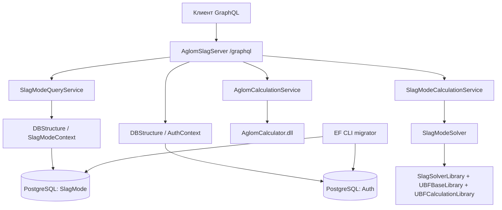

# Архитектура AglomSlagApplication

Документ для агентов, выполняющих багфиксы и добавление функций. Описывает текущее устройство репозитория, а не целевую архитектуру. Дата исследования: 25.10.2026. Имя `arcitecture.md` сохранено по заданию.

## С чего начать

1. Прочитать этот файл и [requests/README.md](requests/README.md).
2. Проверить `git status --short` и локальные инструкции `AGENTS.md`, если они появятся. На момент исследования их нет.
3. Найти нужный маршрут в `Soft/AglomSlagServer/GraphQL/Queries/Query.cs` или `GraphQL/Mutations/Mutation.cs`.
4. Сопоставить контракт с [requests/schema.graphql](requests/schema.graphql), полученным от работающего API. Схема выводится из C# автоматически: публичное свойство сущности может стать частью API.
5. Для изменения хранения читать сущность, `DbContext`, последний snapshot и цепочку миграций соответствующего контекста. Для расчётов читать адаптер и DTO; исходники математических DLL не входят в проект.

В репозитории нет фронтенда, отдельных REST-контроллеров, .NET-тестовых проектов и CI-конфигурации. Автоматические HTTP-тесты всех 16 GraphQL-операций находятся в `tests` и запускаются встроенным runner Node.js. Все исходники приложения находятся в `Soft` (именно с заглавной `S`; важно для Linux).

## Карта репозитория

```text
arcitecture.md                         # эта карта и инструкции по изменению кода
requests/                              # подключение, SDL, операции и JSON-примеры
tests/
  README.md                            # запуск, покрытие и границы проверок
  Run-ApiTests.ps1                      # сборка, временный стенд, тесты, очистка
  compose.api-tests.yml                 # отдельные PostgreSQL, migrator, API
  api/
    helpers.mjs                        # HTTP, примеры, фикстуры и очистка записей
    catalog.test.mjs                    # печи и справочник компонентов
    variants.test.mjs                   # варианты, связи, FK и атомарность
    calculations.test.mjs               # оба расчёта и отрицательные входы
    contract.test.mjs                   # hello, SDL и валидация GraphQL
Soft/
  Docker-compose.yml                   # оркестрация трёх контейнеров
  .dockerignore
  AglomSlagServer/
    AglomSlagServer.slnx                # решение со всеми тремя C#-проектами
    Program.cs                         # DI, конфигурация EF, GraphQL, запуск
    GraphQL/Queries/Query.cs            # 5 корневых query
    GraphQL/Mutations/Mutation.cs       # 11 корневых mutation
    GraphQL/Types/                     # выходные DTO агломерата и входные DTO
    Services/                          # адаптеры расчётов и CRUD
    appsettings*.json
    Properties/launchSettings.json
  DBStructure/
    DbContexts/                        # SlagModeContext и AuthContext
    Entities/SlagMode/                  # печи, справочник, варианты и их компоненты
    Entities/Auth/User.cs
    Migrations/SlagMode/                # собственная история SlagModeContext
    Migrations/Auth/                    # собственная история AuthContext
    DBInitializer.cs                   # вспомогательный класс, сейчас не вызывается
  SlagModeSolver/
    SlagModeSolver.cs                   # адаптер математических библиотек
    DTOs/                              # InputData* / Material / OutputSlagMode
  MathLibs/                            # только готовые DLL
  docker/
    api/Dockerfile                     # сборка и runtime API
    migrator/Dockerfile                 # SDK + dotnet-ef + исходники
    migrator/entrypoint.sh              # последовательные миграции двух контекстов
    postgres/Dockerfile
    postgres/init-scripts/01-create-database.sql
```

## Границы компонентов и зависимости

`AglomSlagServer` — единственное постоянно работающее .NET-приложение (ASP.NET Core). `DBStructure` и `SlagModeSolver` — библиотеки классов, подключаемые через `ProjectReference`; у них нет собственного порта или процесса. Docker-сервис `migrator` запускает EF CLI с API в качестве startup-проекта и завершается.



Прямые зависимости проектов:

| Проект | Зависимости |
|---|---|
| `AglomSlagServer` | `DBStructure`, `SlagModeSolver`, все 4 DLL из `MathLibs` |
| `DBStructure` | EF Core, Npgsql; не зависит от API/solver |
| `SlagModeSolver` | `SlagSolverLibrary.dll`, `UBFBaseLibrary.dll`, `UBFCalculationLibrary.dll`; не зависит от EF/API |

Во всех проектах `net10.0`, nullable и implicit usings включены. Пакеты зафиксированы в `.csproj`: HotChocolate.AspNetCore `16.6.6`, EF Core/Design/Tools/Relational `10.0.12`, Npgsql.EntityFrameworkCore.PostgreSQL `10.0.3`, Google.OrTools `9.15.6755` (последний явно подключён в API). `global.json`, lock-файлов NuGet и локального manifest для `dotnet-ef` нет. В Docker SDK/runtime используются плавающие теги `10.0`, PostgreSQL — `16-alpine`; мигратор устанавливает `dotnet-ef` без версии, поэтому повторная сборка может получить другой инструмент.

Имена namespace исторически неоднородны: сервисы API — `AglomGraphQL.Api.Services`, query — `AglomSlagServer.Queries`, mutation — `AglomSlagServer.Mutations`, DTO API — `AglomSlagServer.Types`. Расположение файла не обязано совпадать с namespace. В namespace `SlagModeSolver` есть класс с тем же именем.

## Запуск, конфигурация и DI

Команды из корня репозитория:

```powershell
docker compose -f Soft/Docker-compose.yml build --no-cache
docker compose -f Soft/Docker-compose.yml up -d
docker compose -f Soft/Docker-compose.yml ps -a
docker compose -f Soft/Docker-compose.yml logs --tail 100 migrator graphql-api
```

Из `Soft` эквивалентны `docker-compose build --no-cache` и `docker-compose up -d`. При автоматизации лучше явно указывать файл с его настоящим регистром.

| Контейнер / сервис | Назначение | Адреса и состояние |
|---|---|---|
| `aglom_postgres` / `postgres` | PostgreSQL, две БД | `localhost:5432` с хоста, `postgres:5432` внутри Compose; должен стать healthy |
| `aglom_migrator` / `migrator` | Применение миграций | ждёт healthy PostgreSQL; нормальное завершение `Exited (0)` |
| `aglom_graphql_api` / `graphql-api` | API | ждёт успешный migrator; `http://localhost:5000/graphql`, порт контейнера `8080` |

Именованный volume `postgres_data` хранит данные; Compose добавляет префикс проекта (обычно `soft_postgres_data`). `PGDATA=/var/lib/postgresql/data/pgdata`. Init SQL создаёт `"SlagMode"` и `"Auth"` только при первом запуске пустого каталога PostgreSQL. Обычные build/up не очищают данные. `down -v` удаляет volume и не является способом штатного обновления.

Compose содержит локальные настройки `postgres/postgres`, БД `SlagMode` и `Auth`. Файл `.env` в исследованном рабочем дереве отсутствует; в Compose нет ссылок `${...}` или `env_file`. Поэтому создание `.env` само по себе не подменит зашитые строки подключения. При иных доступах нужны явные environment/Compose overrides.

`Program.cs` регистрирует две `AddPooledDbContextFactory<T>` с пулом 128. Параметры читаются через `GetConnectionString("SlagModeContext")` и `GetConnectionString("AuthContext")`. CRUD создаёт и освобождает контекст на каждый метод (`await using`); не делить один `DbContext` между параллельными резолверами.

Scoped-сервисы: `AglomCalculationService`, `AglomCalculatorService` (из DLL), `SlagModeQueryService`, `SlagModeCalculationService`. Затем регистрируются корневые GraphQL-типы и `app.MapGraphQL()` без специального пути. `IncludeExceptionDetails=true` включён для всех окружений.

В начале запуска API вызывает `CanConnectAsync` обоих контекстов. Возвращаемые `bool` игнорируются: сообщение об успехе не гарантирует доступность БД. Исключение только логируется, API продолжает запуск. Миграции из `Program.cs` не применяются. Отдельных health/readiness endpoint нет; `hello` проверяет доступность GraphQL, но не БД и не математических DLL.

Для запуска из IDE нужен **SDK .NET 10**, одного установленного runtime недостаточно:

```powershell
dotnet restore Soft/AglomSlagServer/AglomSlagServer.slnx
dotnet build Soft/AglomSlagServer/AglomSlagServer.slnx -c Release --no-restore
dotnet run --project Soft/AglomSlagServer --launch-profile http
```

Профиль `http`: `http://localhost:5093/graphql`, `Development`; профиль `https` добавляет `https://localhost:7165/graphql`. Только `appsettings.Development.json` содержит локальные строки подключения. В Production их передаёт Compose через `ConnectionStrings__SlagModeContext` / `ConnectionStrings__AuthContext`; мигратор использует отдельные `CONNECTION_SLAG` / `CONNECTION_AUTH`. Переменные окружения ASP.NET переопределяют JSON. Фиксированная строка лога про порт 8080 не отражает порт профиля IDE.

API Dockerfile выполняет restore решения, publish Release и перенос в ASP.NET runtime, устанавливает `libgfortran5`, `libz-dev`, `libc6`. Сохранять нативные зависимости при изменении образа. Мигратор собирает проекты при выполнении `dotnet ef`; `entrypoint.sh` должен оставаться с LF и исполняемым в Linux. `.dockerignore` исключает `bin`, `obj`, IDE-каталоги и Markdown; документация вне `Soft` не попадает в build context.

## Контракты API и загрузка данных

Полный каталог операций, входные поля, примеры и инструкции подключения находятся в [requests](requests/README.md). Единственный прикладной HTTP endpoint — `/graphql`; нет login/register, REST CRUD или subscriptions.

Hot Chocolate выводит схему из C#: `GetBlastFurnaces()` становится `blastFurnaces`, `InputDataModel` во входе — `InputDataModelInput`, `float` и `double` — GraphQL `Float`, идентификаторы — `Int`, не `ID`. Химические обозначения чувствительны к регистру (`caO`, `siO2`, `feOinAgl`, `reportCaO_SiO2`). Все поля существующих input-типов в сохранённой SDL обязательны, значений по умолчанию в SDL нет.

`SlagModeQueryService` обслуживает **и чтение, и CRUD**. Списки целиком материализуются через `ToListAsync`, без пагинации, сортировки, фильтров, `AsNoTracking` и DataLoader. GraphQL не оптимизирует SQL под selection set: `.AddProjections/.AddFiltering/.AddSorting` не зарегистрированы.

`GetCalcVariantsAsync` и `GetCalcVariantByIdAsync` включают только `BlastFurnace` и `ComponentVariants`. Остальные навигации не загружаются явно. EF relationship fixup может заполнить часть обратных ссылок в пределах уже загруженного графа; это не полная загрузка связей. Например, `blastFurnaces { calcVariants }` не является заменой корневому `calcVariants`. `ComponentVariant.ComponentGuide` может остаться `null`, хотя схема объявляет его `!`. Контекст к моменту сериализации результата уже освобождён. Не рассчитывать на lazy loading или произвольный обход навигаций.

Авторизация и аутентификация middleware не настроены; `UserId` принимается от клиента и не проверяется. `AuthContext` создаётся, но пользователи не доступны через корневые операции API. В seed есть тестовая запись `UserId=-1`, `UserName=test`, `UserEmail=test@test.test`; поле `PasswordHash` заполнено тестовой строкой, это не работающий механизм входа. CORS middleware не настроен; браузерный клиент с другого origin потребует отдельной настройки.

## Хранение и целостность

Один PostgreSQL обслуживает две независимые базы, между ними нет FK или общей транзакции.

| База / таблица | Ключ и данные | Связи / правила удаления |
|---|---|---|
| `SlagMode.BlastFurnaces` | `BfId` identity, `BfName` | 1:N к `CalcVariants`; удаление используемой печи запрещено (`Restrict`) |
| `SlagMode.ComponentsGuide` | `ComponentId` identity, `ComponentName`, `UserId`, 8 показателей состава | 1:N к `ComponentVariants`; используемый компонент удалять нельзя (`Restrict`) |
| `SlagMode.CalcVariants` | `VariantId` identity, `BfId`, `CalcDate`, имя, `IsImport`, состав кокса/шлака/чугуна | FK на печь; nullable `ParentId` на вариант (`Restrict`); дети-компоненты удаляются каскадно |
| `SlagMode.ComponentVariants` | составной PK `(VariantId, ComponentId)`, имя, расход и копия состава | FK на вариант (`Cascade`) и справочник (`Restrict`) |
| `Auth.Users` | `UserId` identity, nullable `UserName`, обязательные `PasswordHash`, `UserEmail` | связи с `SlagMode` отсутствуют |

В таблице выше запись `SlagMode.X` означает «таблица X в базе SlagMode», а не SQL schema. Используется стандартная PostgreSQL schema `public`; имена таблиц и столбцов Camel/PascalCase, в SQL нужны двойные кавычки: `SELECT * FROM "CalcVariants"`.

Состав справочника и компонента варианта: `FeContent`, `SiO2Content`, `Al2O3Content`, `CaOContent`, `MgOContent`, `SContent`, `MnOContent`, `TiO2Content`. `ComponentVariant` хранит самостоятельный снимок переданных клиентом значений. Изменение справочника не пересчитывает сохранённые варианты. Один `ComponentId` нельзя повторить дважды в одном варианте.

`CalcVariantInput` покрывает скалярные поля варианта, кроме `VariantId`, `SaveTime`, `ParentId`. Создание проверяет наличие печи, затем одним `SaveChangesAsync` сохраняет вариант и компоненты. Наличие компонентов проверяется FK БД. Обновление — полная замена скалярных данных и списка компонентов: старые строки `RemoveRange`, новые создаются заново. Пустой список очищает состав. При обновлении отдельной проверки печи нет, сработает FK. Конкурентного version/token-контроля нет.

`ParentId/Parent/Children` существуют в EF/GraphQL output, но не задаются через текущий input и CRUD. При внешнем создании дочерних вариантов удаление родителя блокируется FK; специального понятного сообщения в сервисе для этого случая нет. Удаление печи/справочного компонента дополнительно проверяет использование и выдаёт исключение со списком вариантов. Update отсутствующего объекта возвращает `null`; delete отсутствующего — `false`.

`UpdateCalcVariantAsync` загружает только компоненты, без печи. Выбор `blastFurnace` в ответе mutation даёт `HC0018` (non-null violation), хотя `SaveChangesAsync` уже выполнен. После такого ответа проверять состояние отдельным query, прежде чем повторять запись. Пример `UpdateCalcVariant.graphql` исключает эту связь; получить её можно через `calcVariantById`.

Числа хранения — C# `float` / PostgreSQL `real`, расчёты — `double`. `CalcDate` — `timestamp with time zone`: в API передавать UTC ISO 8601 (`2026-01-01T00:00:00Z`). Не менять масштабы процентов и единицы автоматически при преобразовании DTO.

Seed задан через `HasData`: печь `-1` (`TestBF`), справочник `-1..-8`, вариант `-1`, шесть компонентов варианта `-1..-6`, тестовый пользователь `-1`. Отрицательные идентификаторы настоящие, не обозначение отсутствия записи. Seed-значения применяются миграциями, а не при каждом вызове API; существующие БД могут отличаться от `HasData`.

### Миграции

`SlagMode`: `20260930152651_InitialCreate` → `20261010141957_AddImportFeld` → `20261010145022_AddCalcData` → `20261010153419_FixCalcData` → `20261018094542_EditReferences`. Последняя меняет удаление печи с Cascade на Restrict. `Auth`: `20260930152821_InitialCreate` → `20261010140653_AddUser`.

Мигратор последовательно запускает `dotnet ef database update` для `SlagModeContext` и `AuthContext` (`set -e`: ошибка первого останавливает запуск). Если первая база обновлена, а вторая упала, общей rollback-транзакции между базами нет. Повторный запуск применяет только недостающие миграции.

Новые миграции создавать из корня с явными project/startup/context и отдельной папкой:

```powershell
dotnet ef migrations add MeaningfulChange --context SlagModeContext --project Soft/DBStructure --startup-project Soft/AglomSlagServer --output-dir Migrations/SlagMode
# Для Auth: --context AuthContext --output-dir Migrations/Auth
dotnet ef database update --context SlagModeContext --project Soft/DBStructure --startup-project Soft/AglomSlagServer --connection "Host=localhost;Port=5432;Database=SlagMode;Username=postgres;Password=postgres"
```

Для этих команд установить совместимый `dotnet-ef` 10.x и дать startup-проекту корректные строки подключения для обоих контекстов (например, `ASPNETCORE_ENVIRONMENT=Development`). Не переписывать применённую историю ради изменения модели. Проверять Up/Down и snapshot; миграции для двух контекстов не смешивать. `DBInitializer` сейчас не участвует в запуске: он ищет регистрации базового `DbContext`, а в DI зарегистрированы конкретные фабрики; простое добавление вызова не гарантирует миграцию двух БД.

## Расчёт агломерата

Путь: `Mutation.CalculateAglom` → `AglomCalculationService.Calculate` → mapping в `AglomCalculator.Contracts.CalculateAglomRequest` → `AglomCalculatorService.Calculate` из DLL → mapping в `AglomCalculationResult`.

Передаются шихтовые компоненты, составы известняка/доломита, кокс и его зола, параметры агломерата. `FluxType` определён DLL и в GraphQL имеет значения `LIMESTONE`, `DOLOMITE`. `FeOinAgl` входа маппится в `FeOInAgl` контракта DLL. Все поля состава передаются без пересчёта единиц. Выход содержит список отчётных компонентов (`report*`), строку «Расчёт выполнен» и `id`, равный **переданному `userId`**, а не идентификатору сохранённого расчёта.

`createPreset` обязателен в GraphQL, но сервис его игнорирует. Сохранения результата, создания пресета и проверки пользователя здесь нет. Отдельной валидации или обработки исключений адаптера агломерата нет; ошибки попадут в GraphQL. Численный алгоритм находится в готовой DLL и не описывается догадками.

## Расчёт шлакового режима

Путь: `Mutation.CalculateSlagMode` → `SlagModeCalculationService.Calculate` → `SlagModeSolver.GetTableData` → библиотеки UBF и SlagSolver → `OutputSlagMode`. БД не участвует; сохранение через `addCalcVariant/updateCalcVariant` выполняется отдельно клиентом.

Сервис проверяет непустой список материалов и положительную сумму `Consumption`; затем вызывает solver синхронно. Все исключения логируются со стеком и оборачиваются в `InvalidOperationException("Ошибка расчёта: ...")`. Проверки суммарного расхода недостаточно для валидации химического состава и области применимости математических моделей.

Solver создаёт `SlagMode`, заполняет `BaseChugun`, `BaseSlag`, `BaseKoks`, `BaseShihta`, вызывает `SetPartOfZhRM`. В `BaseSlag` передаются только CaO, SiO2, TiO2. Al2O3 и MgO из того же input используются в отдельном `SlagSolver.Solve(CaO, SiO2, Al2O3, MgO)`. Результаты UBF и SlagSolver объединяются; температура и текущая вязкость рассчитываются через `UBF_Functions`.

`totalMat` — сумма входных расходов. `materialParts` — список словарей по одному материалу с долей `Consumption / totalMaterials` (0..1), в GraphQL это **вложенный список** объектов `{ key, value }`, а не JSON-object. `slagOut` и `balSlagMass` оба берутся из `MassOfOxSlagSum`. `castIronTemp` объявлен в DTO, но нигде не заполняется и сейчас равен 0.

Составы и содержание элементов в seed передаются числами в процентах (например, Fe=58.5, S=0.028), а не долями 0..1; температура — °C. Для расхода и специфических выходов ориентироваться на предметную документацию библиотек и комментарии DTO: сервер не задаёт общую систему единиц. Не выдавать технические примеры за эталон металлургической модели.

## MathLibs: обязательное ограничение

В `Soft/MathLibs` хранятся `AglomCalculator.dll`, `SlagSolverLibrary.dll`, `UBFBaseLibrary.dll`, `UBFCalculationLibrary.dll`. Это готовые библиотеки; часть исходников закрыта, остальные не требуют дальнейшей модификации. Не публиковать закрытые исходники и не добавлять их восстановленные версии в репозиторий. Изменения прикладного поведения делать в DTO/адаптерах/валидации; если нужен новый контракт DLL, согласовать и получить готовую совместимую сборку. В этой задаче все изменения и результаты проверок остаются локально, без push/публикации.

При замене DLL проверить совместимость API-контрактов, целевой runtime и нативные зависимости (особенно расчёт агломерата в Linux). `HintPath` относителен к `.csproj`; DLL нужны на этапе build/publish и копируются в output. Не принимать успешный `hello` за проверку загрузки математического кода.

## Известные ограничения и точки для багфиксов

Это описание текущего поведения, а не уже выполненные исправления:

| Симптом / риск | Где искать и что учитывать |
|---|---|
| `saveTime` изменяется при повторном чтении | `CalcVariant.SaveTime { get; } = DateTime.Now`; отсутствует в EF snapshot/миграциях, вычисляется при материализации объекта. Для исправления нужны решение о UTC, запись свойства и миграция/backfill |
| `castIronTemp=0` | свойство `OutputSlagMode` не заполняется в `GetTableData` |
| `createPreset` ничего не сохраняет | отсутствует ветка обработки в `AglomCalculationService`; `id` результата — `userId` |
| Пустые/неполные навигации или null-ошибки GraphQL | загрузка `.Include`, освобождение контекста, неполное EF fixup; публичные EF-сущности напрямую используются как output |
| Ошибки FK/дубликаты компонентов | проверить `BfId`, `ComponentId`, составной PK; update полностью заменяет список |
| Недостоверный лог подключения | результат `CanConnectAsync` не проверяется |
| SQL/stack trace попадает клиенту | `IncludeExceptionDetails=true` включён и в Production |
| Нет разграничения данных по пользователю | отсутствуют auth middleware, проверка `UserId`, FK на Auth и фильтрация |
| Нельзя получить schema через `__schema` в Production | в проверенном стенде introspection запрещён (`HC0046`), но `GET /graphql?sdl` возвращает SDL |
| Расчёт возвращает ошибку при необычных данных | валидация ограничена, возможны исключения/нечисловые значения из DLL; проверять полный набор результатов, не только один scalar |
| Сборка/миграции отличаются между машинами | теги Docker и версия dotnet-ef не зафиксированы; локально нужен SDK 10, проверить LF у `.sh` |
| Предупреждения `CS8618` при сборке | часть non-null свойств входных/выходных DTO не имеет инициализации; изменение nullable/required влияет и на GraphQL-контракт, поэтому проверять SDL |

## Как вносить изменения

### Новое поле хранения / CRUD

Изменить сущность и EF-конфигурацию, создать миграцию нужного контекста, проверить seed и ограничения FK. Если поле редактируется клиентом, изменить input, **оба** mapping создания/обновления в `SlagModeQueryService` и запросы в `requests`. Решить, требуется ли снимок значения в `ComponentVariant`. Если поле расчётное, отдельно обновить преобразование между хранимым вариантом и расчётным DTO: сейчас это обязанность клиента, серверного загрузить-и-рассчитать нет.

### Новая GraphQL-операция

Добавить тонкий resolver в `Query`/`Mutation`, логику в соответствующий сервис и регистрацию DI, если нужен новый сервис. Сохранить явное управление временем жизни контекстов. Учитывать nullability как публичный контракт; публичное свойство C# может менять SDL. Для сложной загрузки использовать явный output DTO/тип или продуманную загрузку связей. После изменения получить свежий SDL и добавить исполняемый пример/описание.

### Изменение расчёта

Разделять валидацию API, mapping DTO и математическую реализацию DLL. Проверить все mapping: API input → контракт библиотеки → output. При расширении шлакового режима обновить DTO `SlagModeSolver`, адаптер solver и, при необходимости, отдельные DTO сохранения; они не взаимозаменяемы. Согласовать единицы и точность, предусмотреть нулевые делители и нечисловые результаты. Регрессионные примеры брать из согласованных данных, а не подгонять под текущее число.

### Проверки перед завершением

1. Собрать решение или Docker-образы; для изменения БД проверить migrator на существующей базе и на отдельной чистой тестовой базе/volume.
2. Проверить `hello`, чтение БД, отсутствующий ID (`null/false`), новый/изменённый контракт, нужный расчёт с полным selection set.
3. Для CRUD создать свои записи, проверить add/read/update/delete и блокировку удаления используемых справочников, затем убрать только созданные записи. Не использовать seed для разрушительных проверок.
4. Запустить `./tests/Run-ApiTests.ps1` (Docker Linux containers, Compose v2, PowerShell, Node.js 22+). Runner собирает текущий API и применяет миграции к отдельной PostgreSQL в `tmpfs`, проверяет все операции через HTTP, затем удаляет только свой тестовый стенд. SDK .NET 10 на хосте не требуется. При изменении поведения обновить соответствующие тесты; для расчётного изменения добавить целевые регрессионные тесты с допуском для чисел, когда есть согласованный эталон.
5. Обновить `requests/schema.graphql`, `.graphql`, примеры JSON и документацию при изменении API; проверить `git diff --check`, состав diff и отсутствие учётных данных/сгенерированных build-файлов.

## Автоматические тесты API

Подробная инструкция и матрица операций: [tests/README.md](tests/README.md). Тесты написаны на JavaScript ESM с `node:test` и `node:assert/strict`, npm-зависимостей нет. Они вызывают настоящий `/graphql`, используя полные selection set и JSON-входы из `requests`; сервисы, PostgreSQL и математические DLL не подменяются.

`catalog.test.mjs` проверяет CRUD справочников и блокировку удаления используемых записей. `variants.test.mjs` проверяет чтение/запись всех входных полей, замену/очистку состава, связи, снимки компонентов, каскадное удаление и отсутствие частичного сохранения при ошибках FK/дубликатах. `calculations.test.mjs` проверяет оба флюса агломерата, конечность всех выбранных числовых результатов, суммы/доли материалов и ошибочные входы шлакового расчёта. `contract.test.mjs` проверяет `hello`, SDL с точным набором 16 операций, примеры, ошибки GraphQL и отключённую introspection в Production.

Фикстуры создают собственные записи и очищают их после теста; основной Compose и его данные не используются. Адрес `GRAPHQL_TEST_URL` задаётся runner на случайный loopback-порт, автоматического обращения к рабочему API нет. Сравнения `float` выполняются с допуском; изменяющийся `saveTime` исключён из сравнения отката.

Отдельная characterization-проверка воспроизводит известный `HC0018` при выборе `blastFurnace` в результате update и подтверждает запись отдельным query. Она фиксирует дефект, а не его исправление; после исправления ожидание нужно изменить. Проверки расчётов не являются предметной верификацией закрытых DLL и не используют наблюдавшиеся числа как утверждённые эталоны.

Проверено 25.10.2026 после ревью результатов трёх субагентов: **26 тестов прошли, ошибок и пропусков нет** на свежей временной БД с настоящими миграциями. Инфраструктура после прогона удалена. Прикладной код, миграции и API-контракт в рамках добавления тестов не менялись.

## Проверка документации на живом стенде

Результаты, окружение и ограничения фактической проверки записаны в [requests/verification.md](requests/verification.md). Этот раздел не заменяет повторную проверку после изменения кода. SDL нужно обновлять от собранного текущего проекта; сохранённый файл — снимок контракта, не источник генерации сервера.
