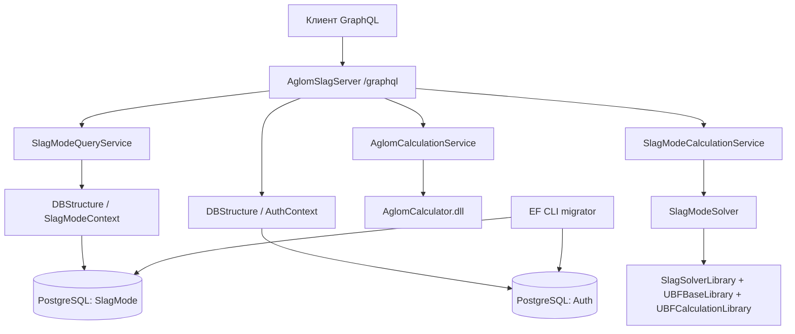

# Архитектура AglomSlagApplication

Документ для агентов, выполняющих багфиксы и добавление функций. Описывает текущее устройство репозитория, а не целевую архитектуру. Дата исследования: 25.10.2026; auth/владельцы обновлены 26.10.2026. Имя `arcitecture.md` сохранено по заданию.

## С чего начать

1. Прочитать этот файл, [правила ведения репозитория](docs/repository-management.md) и [requests/README.md](requests/README.md). Правила размещения задач, журналов и единственного `.env` обязательны и для последующих работ.
2. Проверить `git status --short` и локальные инструкции `AGENTS.md`, если они появятся. На момент исследования их нет.
3. Найти нужный маршрут в `Soft/AglomSlagServer/GraphQL/Queries/Query.cs` или `GraphQL/Mutations/Mutation.cs`.
4. Сопоставить контракт с [requests/schema.graphql](requests/schema.graphql), полученным от работающего API. Схема выводится из C# автоматически: публичное свойство сущности может стать частью API.
5. Для изменения хранения читать сущность, `DbContext`, последний snapshot и цепочку миграций соответствующего контекста. Для расчётов читать адаптер и DTO; исходники математических DLL не входят в проект.

В репозитории нет фронтенда, отдельных REST-контроллеров и CI-конфигурации. Исполняемые .NET-проверки credentials находятся в tests/credentials. Автоматические HTTP-тесты всех 19 GraphQL-операций находятся в `tests` и запускаются встроенным runner Node.js. Все исходники приложения находятся в `Soft` (именно с заглавной `S`; важно для Linux).

Планы: [backend](tasks/TODO.md), [frontend](tasks/TODO_Frontend.md). Настройка общего `.env` и запуск: [docs/configuration.md](docs/configuration.md). Журналы сохранять только в `logs/`, рабочие материалы задач — в `tasks/<ID>/` по [правилам ведения репозитория](docs/repository-management.md).

## Карта репозитория

```text
arcitecture.md                         # эта карта и инструкции по изменению кода
docs/                                  # постоянные инструкции по настройке и ведению проекта
tasks/
  TODO.md                              # backend-план
  TODO_Frontend.md                     # frontend-план
  <ID>/                                # протоколы и рабочие материалы задачи
  <ID>/local/                          # игнорируемые временные и скачанные файлы
logs/                                  # все журналы .log, включая last-run.log
Soft/.env                              # единственные рабочие настройки Docker и IDE (вне Git)
Soft/.env.example                      # безопасный шаблон
requests/                              # подключение, SDL, операции и JSON-примеры
tests/
  README.md                            # запуск, покрытие и границы проверок
  Run-ApiTests.ps1                      # сборка, временный стенд, тесты, очистка
  compose.api-tests.yml                 # отдельные PostgreSQL, migrator, API
  api/
    helpers.mjs                        # HTTP, примеры, фикстуры и очистка записей
    catalog.test.mjs                    # печи и справочник компонентов
    variants.test.mjs                   # варианты, связи, FK и атомарность
    calculations.test.mjs               # оба расчёта и отрицательные входы
    contract.test.mjs                   # hello, SDL и валидация GraphQL
    persistence.test.mjs                # время, связи и валидация сохранения
    error-contract.test.mjs             # публичные ошибки Production
    calculation-roundtrip.test.mjs      # расчёт после сохранения float
  infrastructure/runtime.test.mjs       # SQL, миграции, restart и отказы запуска
Soft/
  Docker-compose.yml                   # оркестрация трёх контейнеров
  .dockerignore
  AglomSlagServer/
    AglomSlagServer.slnx                # решение со всеми тремя C#-проектами
    Program.cs                         # DI, конфигурация EF, GraphQL, запуск
    GraphQL/Queries/Query.cs            # 5 корневых query
    GraphQL/Mutations/Mutation.cs       # 11 корневых mutation
    GraphQL/Types/                     # выходные DTO агломерата и входные DTO
    GraphQL/Types/Outputs/             # отдельные DTO шлака и ограниченные ссылки
    Auth/                              # JWT, credentials, refresh, actor и явные bootstrap-команды
    Services/                          # адаптеры расчётов и CRUD
    Errors/                            # безопасные публичные коды и фильтр GraphQL
    Startup/                           # env-загрузчик, конфигурация и проверка обеих БД
    appsettings*.json
    Properties/launchSettings.json
  DBStructure/
    DbContexts/                        # SlagModeContext и AuthContext
    Entities/SlagMode/                  # печи, справочник, варианты и их компоненты
    Entities/Auth/User.cs
    Migrations/SlagMode/                # собственная история SlagModeContext
    Migrations/Auth/                    # собственная история AuthContext
  SlagModeSolver/
    SlagModeSolver.cs                   # адаптер математических библиотек
    DTOs/                              # InputData* / Material / OutputSlagMode
  MathLibs/                            # только готовые DLL
  docker/
    api/Dockerfile                     # сборка и runtime API
    migrator/Dockerfile                 # SDK + dotnet-ef + исходники
    migrator/entrypoint.sh              # последовательные миграции двух контекстов
    postgres/Dockerfile
    postgres/init-scripts/01-create-database.sql
```

## Границы компонентов и зависимости

`AglomSlagServer` — единственное постоянно работающее .NET-приложение (ASP.NET Core). `DBStructure` и `SlagModeSolver` — библиотеки классов, подключаемые через `ProjectReference`; у них нет собственного порта или процесса. Docker-сервис `migrator` запускает EF CLI с API в качестве startup-проекта и завершается.



Прямые зависимости проектов:

| Проект | Зависимости |
|---|---|
| `AglomSlagServer` | `DBStructure`, `SlagModeSolver`, все 4 DLL из `MathLibs` |
| `DBStructure` | EF Core, Npgsql; не зависит от API/solver |
| `SlagModeSolver` | `SlagSolverLibrary.dll`, `UBFBaseLibrary.dll`, `UBFCalculationLibrary.dll`; не зависит от EF/API |

Во всех проектах `net10.0`, nullable и implicit usings включены. Пакеты зафиксированы в `.csproj`: HotChocolate.AspNetCore/Authorization `16.6.6`, Microsoft.AspNetCore.Authentication.JwtBearer `10.0.13`, EF Core/Design/Tools/Relational `10.0.12`, Npgsql.EntityFrameworkCore.PostgreSQL `10.0.3`, Google.OrTools `9.15.6755`, Mapperly `4.3.1`. Корневой `global.json` и его копия `Soft/global.json` фиксируют SDK `10.0.402`, `rollForward=disable`: нужен именно этот SDK, случайное обновление не допускается. `.config/dotnet-tools.json` и Dockerfile migrator фиксируют `dotnet-ef 10.0.12`. Docker-образы SDK `10.0.402-noble`, ASP.NET `10.0.13-noble`, PostgreSQL `16.15-alpine` закреплены digest. Обновлять версии и digest вместе с проверками миграций и обоих Linux-расчётов. NuGet lock-файлов нет; нативные пакеты apt устанавливаются из репозитория базового образа, побитовая воспроизводимость сборки не заявляется.

Имена namespace исторически неоднородны: сервисы API — `AglomGraphQL.Api.Services`, query — `AglomSlagServer.Queries`, mutation — `AglomSlagServer.Mutations`, DTO API — `AglomSlagServer.Types`. Расположение файла не обязано совпадать с namespace. В namespace `SlagModeSolver` есть класс с тем же именем.

## Запуск, конфигурация и DI

Команды из корня репозитория:

```powershell
docker compose --env-file Soft/.env -f Soft/Docker-compose.yml up -d --build
docker compose --env-file Soft/.env -f Soft/Docker-compose.yml ps -a
docker compose --env-file Soft/.env -f Soft/Docker-compose.yml logs --tail 100 migrator graphql-api
```

Перед запуском заполнить единый `Soft/.env` по [configuration.md](docs/configuration.md). Все команды Compose выполнять с явным `--env-file`; рабочие значения не хранить в JSON/Dockerfile.

| Контейнер / сервис | Назначение | Адреса и состояние |
|---|---|---|
| `aglom_postgres` / `postgres` | PostgreSQL, две БД | `localhost:5432` с хоста, `postgres:5432` внутри Compose; должен стать healthy |
| `aglom_migrator` / `migrator` | Применение миграций | ждёт healthy PostgreSQL; нормальное завершение `Exited (0)` |
| `aglom_graphql_api` / `graphql-api` | API | ждёт успешный migrator; `http://localhost:5000/graphql`, порт контейнера `8080` |

Именованный volume `postgres_data` хранит данные; Compose добавляет префикс проекта (обычно `soft_postgres_data`). `PGDATA=/var/lib/postgresql/data/pgdata`. Init SQL создаёт `"SlagMode"` и `"Auth"` только при первом запуске пустого каталога PostgreSQL. Обычные build/up не очищают данные. `down -v` удаляет volume и не является способом штатного обновления.

Compose требует `DB_USER` и `DB_PASSWORD` из `.env`/окружения без запасного пароля. API/migrator получают `DB_HOST=postgres`, `DB_PORT=5432`, строят строки через NpgsqlConnectionStringBuilder и используют базы `SlagMode`/`Auth`. PostgreSQL получает те же доступы как `POSTGRES_USER`/`POSTGRES_PASSWORD`. Все три build context — `Soft`; env-файлы, включая шаблоны, исключены из Docker. Настройка и ротация существующей роли: [configuration.md](docs/configuration.md).

`Program.cs` регистрирует две `AddPooledDbContextFactory<T>` с пулом 128. Параметры разрешает `Startup/DatabaseConfiguration`: прежние `ConnectionStrings__SlagModeContext` / `ConnectionStrings__AuthContext`, затем `CONNECTION_SLAG` / `CONNECTION_AUTH`, затем обязательные `DB_HOST`, `DB_PORT`, `DB_USER`, `DB_PASSWORD`. CRUD создаёт и освобождает контекст на каждый метод (`await using`); не делить один `DbContext` между параллельными резолверами.

Scoped-сервисы: `AglomCalculationService`, `AglomCalculatorService` (из DLL), `SlagModeQueryService`, `SlagModeCalculationService`. Затем регистрируются корневые GraphQL-типы и `app.MapGraphQL()` без специального пути. `IncludeExceptionDetails` включён только в Development. `PublicErrorFilter` получает зависимости из application provider через factory Hot Chocolate; в Production возвращает только безопасный код и сообщение, в Development дополнительно — тип исключения и SQLSTATE без SQL/стека/сырого сообщения. Диагностика провайдеров, способная раскрыть строки подключения и SQL, отключена; обычный серверный вывод содержит код, тип и SQLSTATE.

`DatabaseStartupCheck` в начале запуска явно проверяет результат `CanConnectAsync` обеих БД, включая случай отказа первой. Любая недоступная или неверно настроенная БД завершает API с кодом 1 до открытия HTTP-порта. При запуске EF tools проверка пропускается через `EF.IsDesignTime`. После успешной проверки БД при `DEMO_BOOTSTRAP=true` выполняется идемпотентный `DemoUserBootstrap`. Адреса логируются из `app.Urls` после запуска. Миграции из `Program.cs` не применяются, неиспользовавшийся `DBInitializer` удалён. Отдельных health/readiness endpoint нет; `hello` проверяет доступность GraphQL, но не текущее состояние БД и математических DLL.

Для запуска из IDE нужен **SDK .NET 10**, одного установленного runtime недостаточно:

```powershell
dotnet restore Soft/AglomSlagServer/AglomSlagServer.slnx
dotnet build Soft/AglomSlagServer/AglomSlagServer.slnx -c Release --no-restore
dotnet run --project Soft/AglomSlagServer --launch-profile http
```

Профиль `http`: `http://localhost:5093/graphql`, `Development`. JSON не содержит секретов. В Development `Startup/LocalEnvironment` загружает единый `Soft/.env` в environment процесса; уже заданные переменные имеют приоритет. Другой путь задаётся через `AGLOMSLAG_ENV_FILE`. В Production env-файлы не читаются: Compose передаёт `DB_*` через environment. Прежние имена полных строк поддерживаются API и migrator. Лог сообщает фактически открытые адреса.

API Dockerfile выполняет restore решения, publish Release и перенос в ASP.NET runtime, устанавливает `libgfortran5`, `libz-dev`, `libc6`. Сохранять нативные зависимости при изменении образа. Мигратор собирает проекты при выполнении `dotnet ef`; `entrypoint.sh` должен оставаться с LF и исполняемым в Linux. `.dockerignore` исключает `bin`, `obj`, IDE-каталоги и Markdown; документация вне `Soft` не попадает в build context.

## Контракты API и загрузка данных

Полный каталог операций, входные поля, примеры и инструкции подключения находятся в [requests](requests/README.md). Единственный прикладной HTTP endpoint — `/graphql`; есть Login (credentials/refresh), Logout, ChangePassword; нет Register, REST CRUD или subscriptions.

Hot Chocolate выводит схему из C#: `GetBlastFurnaces()` становится `blastFurnaces`, `InputDataModel` во входе — `InputDataModelInput`, `float` и `double` — GraphQL `Float`, идентификаторы — `Int`, не `ID`. Химические обозначения чувствительны к регистру (`caO`, `siO2`, `feOinAgl`, `reportCaO_SiO2`). Прежние input-поля обязательны; новые `slag.s` и `slagSContent` имеют явный default `0`, поэтому их можно опускать.

`SlagModeQueryService` обслуживает **и чтение, и CRUD**. Чтение выделено в `SlagModeOutputReader`: `AsNoTracking`, фиксированные по глубине `Include` и `AsSplitQuery`. Количество запросов определяется формой маршрута, а не количеством строк; by-ID и ответы mutation ограничиваются ID до загрузки. Пагинации, сортировки, пользовательских фильтров и DataLoader пока нет. GraphQL не оптимизирует SQL под selection set: `.AddProjections/.AddFiltering/.AddSorting` не зарегистрированы.

Публичные типы хранения отделены от EF: `BlastFurnaceOutput`, `ComponentGuideOutput`, `CalcVariantOutput`, `ComponentVariantOutput` сохраняют GraphQL-имена корневых объектов. Mapperly генерирует перенос скаляров; обязательные ссылки и коллекции собираются явно после загрузки. RMG012/RMG020 для mapper — ошибки сборки. `blastFurnaces.calcVariants` и `componentGuides.componentVariants` возвращают полный связанный набор; вариант включает свою печь, компоненты с их справочником/вариантом, родителя и детей. Навигации ведут в отдельные скалярные `BlastFurnaceReference`, `ComponentGuideReference`, `CalcVariantReference`: обратные рекурсивные связи у них отсутствуют намеренно. Для полного объекта используется корневой query. Граф конечен и сериализуется после освобождения контекста; произвольный циклический обход старых EF-типов больше не часть контракта.

JWT Bearer и field/type authorization Hot Chocolate защищают все Query/Mutation, кроме Login. Auth/CredentialService проверяет IdentityV3 PBKDF2-SHA512 (210000), Auth/RefreshSessionService атомарно ротирует хешированные сессии в PostgreSQL. CurrentActor читает проверенные sub/admin; все доменные чтения фильтруют владельца до материализации, включая вложенные ссылки. Настройки, миграция прежних пользователей, автоматический demo-bootstrap и ограничения: [authentication.md](docs/authentication.md), ручная проверка четырёх задач: [manual-auth-check.md](docs/manual-auth-check.md). CORS пока отдельная WEB-01.

## Хранение и целостность

Один PostgreSQL обслуживает две независимые базы, между ними нет FK или общей транзакции.

| База / таблица | Ключ и данные | Связи / правила удаления |
|---|---|---|
| `SlagMode.BlastFurnaces` | `BfId` identity, `BfName` | 1:N к `CalcVariants`; удаление используемой печи запрещено (`Restrict`) |
| `SlagMode.ComponentsGuide` | `ComponentId` identity, `ComponentName`, `UserId`, 8 показателей состава | 1:N к `ComponentVariants`; используемый компонент удалять нельзя (`Restrict`) |
| `SlagMode.CalcVariants` | `VariantId` identity, обязательный `UserId`, `BfId`, `CalcDate`, имя, `IsImport`, состав кокса/шлака/чугуна | FK на печь; nullable `ParentId` на вариант (`Restrict`); дети-компоненты удаляются каскадно |
| `SlagMode.ComponentVariants` | составной PK `(VariantId, ComponentId)`, имя, расход и копия состава | FK на вариант (`Cascade`) и справочник (`Restrict`) |
| `Auth.Users` | `UserId` identity, `Admin`, `Disabled`, nullable `UserName`, обязательные `PasswordHash`, unique `UserEmail` | связи с `SlagMode` отсутствуют |

В таблице выше запись `SlagMode.X` означает «таблица X в базе SlagMode», а не SQL schema. Используется стандартная PostgreSQL schema `public`; имена таблиц и столбцов Camel/PascalCase, в SQL нужны двойные кавычки: `SELECT * FROM "CalcVariants"`.

Состав справочника и компонента варианта: `FeContent`, `SiO2Content`, `Al2O3Content`, `CaOContent`, `MgOContent`, `SContent`, `MnOContent`, `TiO2Content`. `ComponentVariant` хранит самостоятельный снимок переданных клиентом значений. Изменение справочника не пересчитывает сохранённые варианты. Один `ComponentId` нельзя повторить дважды в одном варианте.

`CalcVariantInput` покрывает скалярные поля варианта, кроме `VariantId`, `SaveTime`, `ParentId`. Создание проверяет наличие печи, затем одним `SaveChangesAsync` сохраняет вариант и компоненты. Наличие компонентов проверяется FK БД. Обновление — полная замена скалярных данных и списка компонентов: старые строки `RemoveRange`, новые создаются заново. Пустой список очищает состав. При обновлении отдельной проверки печи нет, сработает FK. Конкурентного version/token-контроля нет.

`ParentId/Parent/Children` существуют в EF/GraphQL output, но не задаются через текущий input и CRUD. При внешнем создании дочерних вариантов удаление родителя блокируется FK; специального понятного сообщения в сервисе для этого случая нет. Удаление печи/справочного компонента дополнительно проверяет использование и выдаёт исключение со списком вариантов. Update отсутствующего объекта возвращает `null`; delete отсутствующего — `false`.

`UpdateCalcVariantAsync` проверяет печь, компоненты, уникальность ID, имена и UTC-дату до изменения данных. После сохранения ответ заново читается через output reader, поэтому `blastFurnace` относится к актуальному `bfId`, включая смену печи. Используемые справочники и родитель с детьми возвращают `REFERENCE_CONFLICT` при удалении; отсутствующая печь — `REFERENCE_NOT_FOUND`, чужой/отсутствующий компонент во входе — `FORBIDDEN`, неверный input — `VALIDATION_FAILED`. Ограничения БД остаются окончательной защитой, ожидаемые FK/PK-конфликты также превращаются в публичный код. Одна `SaveChangesAsync` сохраняет замену состава атомарно.

`SaveTime` хранится как nullable PostgreSQL `timestamp with time zone`. API задаёт `DateTime.UtcNow` только при создании варианта и сохраняет его при update. Для записей до миграции `20261025091648_PersistVariantSaveTime` и демонстрационного seed возвращается `null`: историческое время неизвестно. Nullable в SDL — намеренное изменение контракта.

Числа хранения — C# `float` / PostgreSQL `real`, расчёты — `double`. `CalcDate` — `timestamp with time zone`: в API передавать UTC ISO 8601 (`2026-01-01T00:00:00Z`). Не менять масштабы процентов и единицы автоматически при преобразовании DTO.

Seed задан через `HasData`: печь `-1` (`TestBF`), справочник `-1..-8`, вариант `-1`, шесть компонентов варианта `-1..-6`, тестовый пользователь `-1`. Отрицательные идентификаторы настоящие, не обозначение отсутствия записи. Seed-значения применяются миграциями, а не при каждом вызове API; существующие БД могут отличаться от `HasData`.

### Миграции

`SlagMode`: `20260930152651_InitialCreate` → `20261010141957_AddImportFeld` → `20261010145022_AddCalcData` → `20261010153419_FixCalcData` → `20261018094542_EditReferences` → `20261025091648_PersistVariantSaveTime` → `20261025093431_AddSlagSulfurContent` → `20261026125625_VariantOwnership`. `EditReferences` меняет удаление печи с Cascade на Restrict, `PersistVariantSaveTime` добавляет nullable время создания без поддельного backfill, последняя миграция — фактическую серу шлака с совместимым default 0. `Auth`: `20260930152821_InitialCreate` → `20261010140653_AddUser` → `20261026124711_SecureCredentials` → `20261026125533_RefreshSessions`. SecureCredentials очищает хеши и отключает прежних пользователей; demo-bootstrap при обычном запуске восстанавливает демонстрационный аккаунт, прочим пользователям нужен явный сброс. VariantOwnership назначает прежние варианты/справочник пользователю -1 и добавляет демо-вариант -2. RefreshSessions добавляет транзакционный триггер отзыва сессий при смене пароля/блокировке.

Мигратор последовательно запускает `dotnet ef database update` для `SlagModeContext` и `AuthContext` (`set -e`: ошибка первого останавливает запуск). Если первая база обновлена, а вторая упала, общей rollback-транзакции между базами нет. Повторный запуск применяет только недостающие миграции.

Новые миграции создавать из корня с явными project/startup/context и отдельной папкой:

```powershell
dotnet ef migrations add MeaningfulChange --context SlagModeContext --project Soft/DBStructure --startup-project Soft/AglomSlagServer --output-dir Migrations/SlagMode
# Для Auth: --context AuthContext --output-dir Migrations/Auth
$env:ASPNETCORE_ENVIRONMENT = 'Development' # загрузить .env
dotnet ef database update --context SlagModeContext --project Soft/DBStructure --startup-project Soft/AglomSlagServer
```

Для этих команд выполнить `dotnet tool restore` из корня: manifest закрепляет `dotnet-ef 10.0.12`. Дать startup-проекту корректные строки подключения для обоих контекстов (например, `ASPNETCORE_ENVIRONMENT=Development`). Не переписывать применённую историю ради изменения модели. Проверять Up/Down и snapshot; миграции для двух контекстов не смешивать. Единственный автоматический механизм миграций — Compose migrator.

## Расчёт агломерата

Путь: `Mutation.CalculateAglom` → `AglomCalculationService.Calculate` → mapping в `AglomCalculator.Contracts.CalculateAglomRequest` → `AglomCalculatorService.Calculate` из DLL → mapping в `AglomCalculationResult`.

Передаются шихтовые компоненты, составы известняка/доломита, кокс и его зола, параметры агломерата. `FluxType` определён DLL и в GraphQL имеет значения `LIMESTONE`, `DOLOMITE`. `FeOinAgl` входа маппится в `FeOInAgl` контракта DLL. Все поля состава передаются без пересчёта единиц. Выход содержит список отчётных компонентов (`report*`), строку «Расчёт выполнен» и `id`, равный **переданному `userId`**, а не идентификатору сохранённого расчёта.

`createPreset` обязателен в GraphQL, но сервис его игнорирует. Сохранения результата, создания пресета и проверки пользователя здесь нет. Отдельной валидации или обработки исключений адаптера агломерата нет; ошибки попадут в GraphQL. Численный алгоритм находится в готовой DLL и не описывается догадками.

## Расчёт шлакового режима

Путь: `Mutation.CalculateSlagMode` → `SlagModeCalculationService.Calculate` → `SlagModeSolver.GetTableData` → библиотеки UBF и SlagSolver → `OutputSlagMode`. БД не участвует; сохранение через `addCalcVariant/updateCalcVariant` выполняется отдельно клиентом.

Сервис проверяет обязательные объекты, конечность чисел, непустой список, неотрицательный индивидуальный расход (ноль допустим), положительную конечную сумму расходов, проценты 0–100 и ненулевой SiO2 в делителе основности. Температура должна быть выше абсолютного нуля; предметную границу жидкого состояния без модели фазового состава сервер не выдумывает. До сериализации проверяется конечность всего результата, независимо от selection set. Некорректный input возвращает `VALIDATION_FAILED`, исключение DLL или нечисловой результат — безопасный `CALCULATION_FAILED`. Сырые исключения, SQL и входные данные не отправляются клиенту.

Solver создаёт `SlagMode`, заполняет `BaseChugun`, `BaseSlag`, `BaseKoks`, `BaseShihta`, вызывает `SetPartOfZhRM`. В `BaseSlag` передаются CaO, SiO2, TiO2 и фактическая сера S. Al2O3 и MgO из того же input используются в отдельном `SlagSolver.Solve(CaO, SiO2, Al2O3, MgO)`. Результаты UBF и SlagSolver объединяются; температура и текущая вязкость рассчитываются через `UBF_Functions`.

`totalMat` — сумма входных расходов. `materialParts` — список словарей по одному материалу с долей `Consumption / totalMaterials` (0..1), в GraphQL это **вложенный список** объектов `{ key, value }`, а не JSON-object. `slagOut` и `balSlagMass` оба берутся из `MassOfOxSlagSum`: это два имени одного значения текущего адаптера, а не независимые балансы. `castIronTemp` возвращает входной `iron.temp`; `slagTemperature` сохраняет отдельный вызов DLL.

Ранее `sDistribution=0` возникал потому, что `BaseSlag.S` не заполнялся. Новые необязательные `slag.s` и сохраняемое `slagSContent` передают фактическую серу, %; старые запросы и записи сохраняют прежнее вычислительное допущение `0`, которое не следует считать измеренным историческим значением. Миграция `20261025093431_AddSlagSulfurContent` добавляет PostgreSQL `real DEFAULT 0`. Публичный эксперимент DLL и HTTP-регрессия: `(S)=0.16/0.32`, `[S]=0.016` дают коэффициенты 10/20. Нелинейная часть DLL этим не верифицируется. Для нормальных binary32 чисел ошибка хранения ограничена `|x|·2^-24`; для отношения серы — `|ratio|·2u/(1-u)`, `u=2^-24`. Общую допустимую ошибку непрозрачных нелинейных формул из одной точности входа вывести нельзя.

Составы и содержание элементов в seed передаются числами в процентах (например, Fe=58.5, S=0.028), а не долями 0..1; температура — °C. Для расхода и специфических выходов ориентироваться на предметную документацию библиотек и комментарии DTO: сервер не задаёт общую систему единиц. Не выдавать технические примеры за эталон металлургической модели.

## MathLibs: обязательное ограничение

В `Soft/MathLibs` хранятся `AglomCalculator.dll`, `SlagSolverLibrary.dll`, `UBFBaseLibrary.dll`, `UBFCalculationLibrary.dll`. Это готовые библиотеки; часть исходников закрыта, остальные не требуют дальнейшей модификации. Не публиковать закрытые исходники и не добавлять их восстановленные версии в репозиторий. Изменения прикладного поведения делать в DTO/адаптерах/валидации; если нужен новый контракт DLL, согласовать и получить готовую совместимую сборку. В этой задаче все изменения и результаты проверок остаются локально, без push/публикации.

При замене DLL проверить совместимость API-контрактов, целевой runtime и нативные зависимости (особенно расчёт агломерата в Linux). `HintPath` относителен к `.csproj`; DLL нужны на этапе build/publish и копируются в output. Не принимать успешный `hello` за проверку загрузки математического кода.

## Известные ограничения и точки для багфиксов

Это описание текущего поведения, а не уже выполненные исправления:

| Симптом / риск | Где искать и что учитывать |
|---|---|
| Историческое `saveTime=null` | намеренно: время старых записей неизвестно; новые записи хранят стабильное UTC-время |
| `castIronTemp` | исправлен: входная температура чугуна; не подменяет температуру шлака |
| `createPreset` ничего не сохраняет | отсутствует ветка обработки в `AglomCalculationService`; `id` результата — `userId` |
| Навигации GraphQL | исправлены через отдельные DTO и явную загрузку; скалярные Reference-типы ограничивают глубину обхода |
| Ошибки FK/дубликаты компонентов | preflight-валидация с публичными кодами и окончательные ограничения БД; update полностью заменяет список |
| Диагностика подключения | обе БД проверяются, отказ завершает запуск; сообщения не раскрывают строку подключения |
| Ошибки GraphQL | безопасные публичные коды; SQL/stack trace не возвращаются клиенту |
| Разграничение данных | JWT, серверный UserId, bool Admin и SQL-фильтры всех навигаций; межбазового FK нет |
| Схема и браузерная IDE | GET, SDL и introspection доступны во всех окружениях; бизнес-поля, кроме Login, проверяют JWT |
| Область применимости расчёта | базовая валидация и проверка всего результата шлака введены; фазовая модель и научные эталоны DLL отсутствуют |
| Окружение | SDK/EF CLI и digest образов закреплены; локально нужен SDK 10.0.402, `.sh` сохраняются с LF |
| Предупреждения `CS8618` при сборке | в шлаковых DTO устранены; существующие предупреждения Aglom оставлены по прямому исключению этой области пользователем |

## Как вносить изменения

### Новое поле хранения / CRUD

Изменить сущность и EF-конфигурацию, создать миграцию нужного контекста, проверить seed и ограничения FK. Если поле редактируется клиентом, изменить input, **оба** mapping создания/обновления в `SlagModeQueryService` и запросы в `requests`. Решить, требуется ли снимок значения в `ComponentVariant`. Если поле расчётное, отдельно обновить преобразование между хранимым вариантом и расчётным DTO: сейчас это обязанность клиента, серверного загрузить-и-рассчитать нет.

### Новая GraphQL-операция

Добавить тонкий resolver в `Query`/`Mutation`, логику в соответствующий сервис и регистрацию DI, если нужен новый сервис. Сохранить явное управление временем жизни контекстов. Учитывать nullability как публичный контракт; публичное свойство C# может менять SDL. Для сложной загрузки использовать явный output DTO/тип или продуманную загрузку связей. Все новые корневые поля наследуют авторизацию Query/Mutation; AllowAnonymous разрешён только Login. Из общего root не проверять личность в конструкторе: она нужна при выполнении защищённого сервиса. Для новых путей записи сохранять назначение владельца сервером и запрет изменений импортов. После изменения обновить публичный SDL через `tests/Run-ApiTests.ps1 -UpdateSchema` и добавить исполняемый пример/описание.

### Изменение расчёта

Разделять валидацию API, mapping DTO и математическую реализацию DLL. Проверить все mapping: API input → контракт библиотеки → output. При расширении шлакового режима обновить DTO `SlagModeSolver`, адаптер solver и, при необходимости, отдельные DTO сохранения; они не взаимозаменяемы. Согласовать единицы и точность, предусмотреть нулевые делители и нечисловые результаты. Регрессионные примеры брать из согласованных данных, а не подгонять под текущее число.

### Проверки перед завершением

1. Собрать решение или Docker-образы; для изменения БД проверить migrator на существующей базе и на отдельной чистой тестовой базе/volume.
2. Проверить `hello`, чтение БД, отсутствующий ID (`null/false`), новый/изменённый контракт, нужный расчёт с полным selection set.
3. Для CRUD создать свои записи, проверить add/read/update/delete и блокировку удаления используемых справочников, затем убрать только созданные записи. Не использовать seed для разрушительных проверок.
4. Запустить `./tests/Run-ApiTests.ps1` (Docker Linux containers, Compose v2, PowerShell, Node.js 22+, ASP.NET Core runtime .NET 10 для host-проверки). Runner собирает текущий API и применяет миграции к отдельной PostgreSQL в `tmpfs`, проверяет все операции через HTTP, затем удаляет только свой тестовый стенд. SDK .NET 10 на хосте не требуется. При изменении поведения обновить соответствующие тесты; для расчётного изменения добавить целевые регрессионные тесты с допуском для чисел, когда есть согласованный эталон.
5. Обновить `requests/schema.graphql`, `.graphql`, примеры JSON и документацию при изменении API; проверить `git diff --check`, состав diff и отсутствие учётных данных/сгенерированных build-файлов.

## Автоматические тесты API

Подробная инструкция и матрица операций: [tests/README.md](tests/README.md). Тесты написаны на JavaScript ESM с `node:test` и `node:assert/strict`, npm-зависимостей нет. Они вызывают настоящий `/graphql`, используя полные selection set и JSON-входы из `requests`; сервисы, PostgreSQL и математические DLL не подменяются.

`catalog.test.mjs` проверяет CRUD справочников и блокировку удаления используемых записей. `variants.test.mjs` проверяет чтение/запись всех входных полей, замену/очистку состава, связи, снимки компонентов, каскадное удаление и отсутствие частичного сохранения при ошибках FK/дубликатах. `calculations.test.mjs` проверяет оба флюса агломерата, конечность всех выбранных числовых результатов, суммы/доли материалов и ошибочные входы шлакового расчёта. `contract.test.mjs` проверяет `hello`, публичный SDL с точным набором 19 операций и соответствие `requests/schema.graphql`, примеры, ошибки GraphQL и доступную introspection в Production.

Фикстуры создают собственные записи и очищают их после теста; основной Compose и его данные не используются. Адрес `GRAPHQL_TEST_URL` задаётся runner на случайный loopback-порт, автоматического обращения к рабочему API нет. Сравнения `float` выполняются с допуском; сохраняемое `saveTime` включено в сравнение отката.

Прежняя characterization-проверка `HC0018` заменена регрессией успешного ответа со старой/новой печью. `persistence.test.mjs` проверяет сохранённое время и навигации; `error-contract.test.mjs` — безопасные публичные ошибки; `calculation-roundtrip.test.mjs` — сохранность входов с IEEE-754 допуском и расчёт после сохранения. Последовательный `infrastructure/runtime.test.mjs` проверяет SQL, restart, обновление прежней схемы, snapshot, отказ подключения и Development. Проверки расчётов не являются предметной верификацией закрытых DLL и не используют наблюдавшиеся числа как утверждённые эталоны.

Исторический первый набор из 26 тестов описан в `tasks/api-tests/verification.md`. Текущий протокол багфиксов и границы выполненного: [протокол багфиксов](tasks/bugfixes/verification.md). Статус определяется последним завершённым прогоном, а не одним успешным build.

## Проверка документации на живом стенде

Результаты, окружение и ограничения фактической проверки записаны в [первичная проверка API](tasks/api-tests/verification.md). Этот раздел не заменяет повторную проверку после изменения кода. SDL нужно обновлять от собранного текущего проекта; сохранённый файл — снимок контракта, не источник генерации сервера.

## Безопасность после SEC-02/03, OWN-01, SEC-04

Полный контракт и границы: [docs/authentication.md](docs/authentication.md). API слушает HTTP также в Production: `http://localhost:5000/graphql`, порт контейнера `8080`. Compose запускает миграции и затем API с автоматическим идемпотентным DemoUserBootstrap; `DEMO_BOOTSTRAP=true` по умолчанию в Compose и false вне него. Пользователи -1/-2 создаются из `DEMO_USER_EMAIL/PASSWORD` и `DEMO_ADMIN_EMAIL/PASSWORD` в единственном `Soft/.env`. Обычный up/restart сохраняет существующие пароли и данные. Операторский сервис bootstrap профиля setup остаётся для обслуживания. IDE, GET, SDL и introspection доступны публично; все бизнес-поля, кроме Login, требуют JWT, включая документы с соседним Login. AuthContext хранит Users и RefreshSessions, SlagModeContext — обязательный CalcVariant.UserId и индексы. JWT включает sub/admin/sid/jti и ограничен exp; refresh после смены прав перечитывает Auth. Logout/смена пароля/блокировка не отзывают уже выданный access немедленно. История refresh сохраняется для replay без автоматической очистки.

SlagModeOutputReader использует несколько конечных SQL-запросов с фильтрами владельца. Чужие parent/parentId/children скрываются; componentGuide в собственном снимке nullable при чужом справочнике. Владельца input.userId не назначает, admin менять через API нельзя. Печи общие для чтения, CRUD только admin. isImport=true запрещён обычным CRUD; сохранённый оригинал нельзя update/delete ни одной роли. Общий ORM-инвариант IMP-01 и новые child/import-команды остаются отдельными задачами.

Тесты authentication/ownership/sessions/passwords и .NET credentials дополняют прежнюю регрессию. Runner использует Production HTTP, управляемый bootstrap, bearer и отдельные PG-БД; runtime выполняется последним, потому что останавливает тестовый PostgreSQL.
